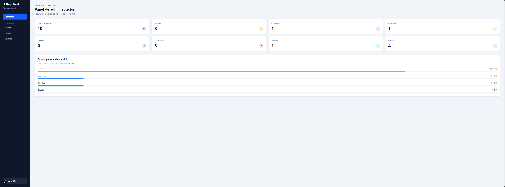
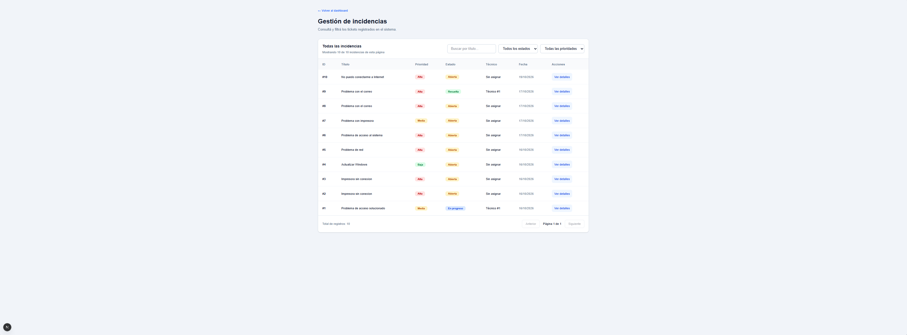

# IT Help Desk — Sistema de Gestión de Incidencias

Sistema web de gestión de incidencias de soporte técnico, desarrollado con **ASP.NET Core (.NET 10), Next.js, TypeScript y PostgreSQL**.

El proyecto permite registrar, administrar y realizar el seguimiento de solicitudes de soporte informático mediante un sistema de autenticación y autorización basado en roles.

Su objetivo es simular el funcionamiento de una mesa de ayuda (*Help Desk*) utilizada en organizaciones para gestionar problemas técnicos, asignar responsables y mantener la trazabilidad de cada solicitud.

## Tecnologías utilizadas

### Backend
- **ASP.NET Core (.NET 10):** desarrollo de la API REST.
- **Entity Framework Core:** acceso a datos mediante ORM.
- **PostgreSQL:** base de datos relacional.
- **JWT (JSON Web Tokens):** autenticación de usuarios.
- **ASP.NET Core Identity PasswordHasher:** almacenamiento seguro de contraseñas mediante hashing.
- **Swagger / OpenAPI:** documentación y pruebas de endpoints, cuando está habilitado.

### Frontend
- **Next.js 16:** aplicación web con App Router.
- **React:** construcción de interfaces.
- **TypeScript:** tipado estático.
- **Tailwind CSS:** estilos y diseño adaptable.

### Herramientas de desarrollo
- Visual Studio Code
- Git y GitHub
- PostgreSQL y pgAdmin
- .NET CLI
- Node.js y npm

## Funcionalidades principales

### Autenticación y autorización
- Registro e inicio de sesión de usuarios.
- Autenticación mediante JWT.
- Contraseñas almacenadas mediante hashing.
- Control de acceso basado en roles.
- Protección de endpoints según los permisos del usuario.

### Administrador

- Visualización de estadísticas generales del sistema.
- Consulta, búsqueda y filtrado de incidencias.
- Asignación y desasignación de técnicos a incidencias.
- Actualización de estados y consulta del historial de cambios.
- Lectura y publicación de comentarios.
- Registro, edición y eliminación de técnicos.
- Creación de cuentas de acceso para técnicos.
- Vinculación automática de las cuentas creadas con sus registros de técnicos.
- Control de acceso a las funciones administrativas mediante autorización por roles.

### Técnico
- Visualización de incidencias asignadas.
- Consulta de detalles y prioridades.
- Actualización del estado de las incidencias.
- Consulta del historial de cambios.
- Comunicación mediante comentarios.

### Usuario
- Creación de nuevas incidencias.
- Consulta de solicitudes propias.
- Búsqueda y filtrado por estado.
- Seguimiento de la resolución de problemas.
- Visualización del técnico asignado.
- Consulta del historial.
- Publicación de comentarios.

## Estados de las incidencias

Las incidencias pueden encontrarse en los siguientes estados:

| Estado | Descripción |
|---|---|
| Abierta | La solicitud fue registrada y está pendiente de atención. |
| En progreso | Se está trabajando en la resolución del problema. |
| Resuelta | El problema fue solucionado. |
| Cerrada | La incidencia fue finalizada. |

Los cambios de estado se registran en un historial que permite identificar las transiciones realizadas, el usuario responsable y la fecha correspondiente.

## Arquitectura del sistema

El proyecto utiliza una arquitectura cliente-servidor:

```text
                    USUARIO
                       |
                       v
             FRONTEND - NEXT.JS
                React + TypeScript
                       |
                    HTTP/JSON
                       |
                       v
              API REST - .NET 10
                       |
             Autenticación JWT
             Autorización por roles
             Lógica de negocio
                       |
                       v
             ENTITY FRAMEWORK CORE
                       |
                       v
                  POSTGRESQL
```

El frontend consume los endpoints de la API REST y presenta interfaces diferentes según el rol del usuario autenticado.

El backend concentra las reglas de negocio, la autorización y las operaciones sobre la base de datos.

## Estructura del proyecto

```text
IT-HelpDesk/
|
|-- HelpDesk.Api/
|   |-- Controllers/
|   |-- Data/
|   |-- DTOs/
|   |-- Migrations/
|   |-- Models/
|   |-- Security/
|   |-- Services/
|   |-- Program.cs
|
|-- helpdesk-web/
|   |-- app/
|   |   |-- admin/
|   |   |-- tecnico/
|   |   |-- usuario/
|   |-- public/
|   |-- package.json
|
|-- .gitignore
|-- README.md
```

## Instalación y ejecución con Docker

El proyecto está preparado para ejecutarse localmente mediante **Docker Compose**, que permite iniciar el frontend, la API REST y PostgreSQL sin instalar cada tecnología por separado.

### Requisitos

- Git.
- Docker Desktop con Docker Compose.

### 1. Clonar el repositorio

```bash
git clone https://github.com/AgusMart28/IT-HelpDesk.git
cd IT-HelpDesk
```

### 2. Configurar las variables de entorno

Crear un archivo `.env` a partir de `.env.example`.

En PowerShell:

```powershell
Copy-Item .env.example .env
```

Editar `.env` y configurar los siguientes valores:

- `POSTGRES_PASSWORD`: contraseña segura para PostgreSQL.
- `JWT_KEY`: clave secreta aleatoria para firmar los tokens JWT.
- `JWT_ISSUER`: identificador del emisor de los tokens.
- `JWT_AUDIENCE`: identificador del destinatario de los tokens.

Para generar una clave JWT aleatoria de 64 bytes codificada en Base64, se puede utilizar PowerShell:

```powershell
$bytes = New-Object byte[] 64
[System.Security.Cryptography.RandomNumberGenerator]::Fill($bytes)
[Convert]::ToBase64String($bytes)
```

Copiar el valor generado en `JWT_KEY` dentro de `.env`.

**Importante:** nunca publicar el archivo `.env` ni utilizar contraseñas reales en archivos versionados.

### 3. Iniciar los servicios

Desde la carpeta principal del proyecto:

```bash
docker compose up -d --build
```

Docker Compose construirá e iniciará los siguientes servicios:

| Servicio | Dirección local |
|---|---|
| Frontend Next.js | http://localhost:3000 |
| API REST ASP.NET Core | http://localhost:5000 |
| PostgreSQL | localhost:5433 |

La API utiliza Entity Framework Core para aplicar automáticamente las migraciones pendientes al iniciar.

### 4. Acceder a la aplicación

Abrir en el navegador:

http://localhost:3000

Se puede registrar una cuenta de usuario desde la interfaz de inicio.

Las funciones administrativas requieren una cuenta con rol `Administrador`. Por seguridad, el registro público no permite asignarse privilegios administrativos.

### 5. Detener los servicios

```bash
docker compose down
```

Este comando detiene y elimina los contenedores, pero conserva los datos almacenados en el volumen de PostgreSQL.

Para volver a iniciar la aplicación:

```bash
docker compose up -d
```

**Nota:** no utilizar `docker compose down -v` si se desea conservar la información almacenada.

## Configuración inicial del administrador

Por seguridad, el registro público crea cuentas con rol `Usuario`. Para acceder al panel administrativo en una instalación local de demostración, es necesario asignar manualmente el rol `Administrador` a una cuenta existente.

### 1. Registrar un usuario

Iniciar la aplicación en http://localhost:3000 y registrar una cuenta con un correo y una contraseña propios.

### 2. Asignar el rol Administrador

Desde PowerShell, en la carpeta principal del proyecto, ejecutar:

```powershell
'UPDATE "Usuarios" SET "Rol" = ''Administrador'' WHERE "Email" = ''admin@ejemplo.com'';' | docker compose exec -T db psql -U helpdesk -d helpdesk_db
```

Reemplazar `admin@ejemplo.com` por el correo de la cuenta registrada.

El comando debe indicar `UPDATE 1`, lo que confirma que se actualizó una cuenta.

### 3. Iniciar sesión nuevamente

Cerrar la sesión actual y volver a iniciar sesión con la misma cuenta.

El sistema generará un nuevo token JWT con el rol `Administrador`, permitiendo acceder al panel administrativo.

**Advertencia:** este procedimiento está destinado exclusivamente a entornos locales de desarrollo o demostración. En producción, la asignación de privilegios administrativos debe realizarse mediante un mecanismo de aprovisionamiento seguro.

## Seguridad

El proyecto incorpora las siguientes medidas:

- Autenticación basada en JWT.
- Validación de firma y expiración de tokens.
- Autorización mediante roles.
- Hashing de contraseñas.
- Restricción de acceso a incidencias según el usuario y el técnico asignado.
- Validaciones de datos desde el backend.
- Almacenamiento local de credenciales de desarrollo mediante .NET User Secrets.

**Nota:** el almacenamiento de tokens en `sessionStorage` corresponde a la implementación actual de desarrollo. Para un despliegue público se recomienda revisar la gestión de sesiones y utilizar un mecanismo más robusto, como cookies HttpOnly configuradas adecuadamente.

## Capturas de pantalla

### Inicio de sesión

Autenticación de usuarios para acceder a las funcionalidades correspondientes a su rol.


### Panel de administración

Vista general del sistema con estadísticas sobre incidencias, estados, técnicos y usuarios.



### Gestión de incidencias

Listado de solicitudes con búsqueda, filtros por estado y prioridad, y acceso a los detalles.



### Panel del técnico

Consulta de incidencias asignadas y seguimiento de su resolución.


### Panel del usuario

Visualización de incidencias propias y acceso a la creación de nuevas solicitudes.


### Detalle y seguimiento de incidencias

Consulta de información del ticket, gestión de estados, historial de cambios y comentarios.


## Estado del proyecto

**Versión funcional para demostración y portfolio.**

El sistema integra una aplicación web desarrollada con Next.js, una API REST construida con ASP.NET Core y una base de datos PostgreSQL. Los tres servicios se ejecutan mediante Docker Compose.

Se verificó manualmente el funcionamiento de los tres roles principales y el flujo completo de atención de incidencias:

1. Un usuario registra una solicitud de soporte técnico.
2. El administrador consulta la incidencia y la asigna a un técnico.
3. El técnico inicia sesión y visualiza las incidencias asignadas.
4. El técnico actualiza el estado de la solicitud y agrega comentarios.
5. El usuario puede consultar el seguimiento de su incidencia.

### Mejoras futuras

- Incorporación de pruebas automatizadas.
- Revisión adicional de seguridad y autorización.
- Mejoras en la gestión de sesiones.
- Despliegue en un entorno público.

## Autor

**Agustín Martínez**

Proyecto personal desarrollado como práctica de desarrollo full stack, APIs REST, bases de datos relacionales y seguridad de aplicaciones web.